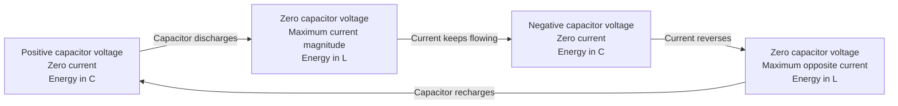
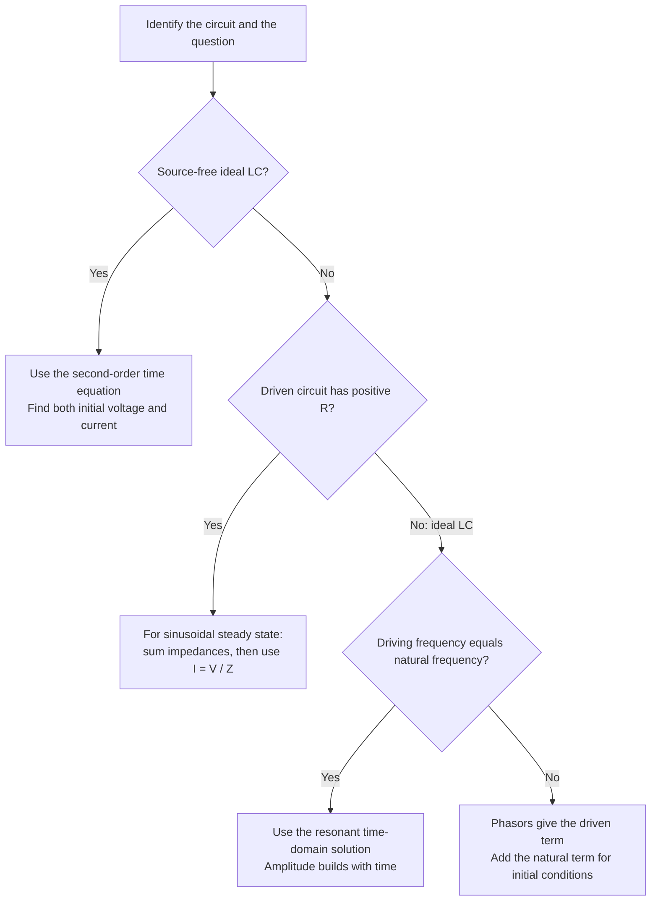

#### LC Resonance

- [[#Prerequisites]]
- [[#Source-free LC: energy moves between two stores]]
- [[#Natural frequency and initial conditions]]
- [[#Driving an ideal LC circuit]]
- [[#Why exact resonance needs a different solution]]
- [[#Adding resistance: series RLC resonance]]
- [[#Worked series RLC example]]
- [[#Choosing the right method]]

**[[#Natural frequency and initial conditions|Natural frequency]]**
$$\omega_n=\frac1{\sqrt{LC}},\qquad f_n=\frac1{2\pi\sqrt{LC}},\qquad T_n=2\pi\sqrt{LC}$$
**[[#Driving an ideal LC circuit|Ideal series LC, capacitor-voltage ratio]]**
$$\frac{\underline V_C}{\underline V_s}=\frac{\omega_n^2}{\omega_n^2-\omega^2}\qquad(\omega\ne\omega_n)$$
**[[#Why exact resonance needs a different solution|Ideal LC at resonance, initially unenergised]]**
$$v_s(t)=V_m\cos(\omega_nt)\quad\Longrightarrow\quad v_C(t)=\frac{V_m\omega_n}{2}t\sin(\omega_nt)$$
**[[#Adding resistance: series RLC resonance|Series RLC admittance]]**
$$|Y|=\frac1{\sqrt{R^2+\left(\omega L-\frac1{\omega C}\right)^2}},\qquad |Y|_{\max}=\frac1R\quad\text{at }\omega=\omega_n$$

## Prerequisites

This builds on [[RL and Complete Response]], [[AC Impedance]] and [[From Impedance Triangles to Complex Numbers]]. Here $R,L,C$ are positive, ideal component values. In time-domain examples $V_m$ is a **peak** voltage; phasor ratios work with either peak or RMS amplitudes provided the convention is consistent. Continue with [[RLC Resonance and Bandwidth]] for power, bandwidth and quality factor.

## Source-free LC: energy moves between two stores

An ideal source-free LC circuit contains no resistor to dissipate energy and no source to add it. It can still carry current because the capacitor or inductor already contains energy:
$$W_C=\frac12Cv_C^2,\qquad W_L=\frac12Li^2.$$
Unlike an RC or RL discharge, the energy does not simply decay. It passes between the capacitor's electric field and the inductor's magnetic field.[^sourcefree]

For a capacitor initially charged positively with zero current:

The inductor keeps current flowing after the capacitor voltage reaches zero, so the capacitor charges with the opposite polarity. The signs reverse every half-cycle, but the stored energies depend on the **squares** of voltage and current.

For ideal components,
$$\frac{d}{dt}\left(\frac12Cv_C^2+\frac12Li^2\right)=0.$$
The oscillation therefore has constant amplitude. Real losses would make a source-free oscillation decay.

## Natural frequency and initial conditions

Choose a loop current $i$ that enters the capacitor's positive terminal, and use passive voltage drops. Then
$$i=C\frac{dv_C}{dt},\qquad v_L=L\frac{di}{dt},\qquad v_L+v_C=0.$$
Substituting for current gives
$$LC\frac{d^2v_C}{dt^2}+v_C=0,$$
or
$$\frac{d^2v_C}{dt^2}+\omega_n^2v_C=0,\qquad \omega_n=\frac1{\sqrt{LC}}.$$
This is the same equation as simple harmonic motion. The circuit values determine the oscillation frequency; the initial stored energy determines the amplitude.[^sourcefree]

A second-order equation needs **two initial conditions**, normally $v_C(0)=V_0$ and $i(0)=I_0$. With the current reference above,
$$v_C(t)=V_0\cos(\omega_nt)+\frac{I_0}{\omega_nC}\sin(\omega_nt),$$
$$i(t)=-\omega_nCV_0\sin(\omega_nt)+I_0\cos(\omega_nt).$$
This sine-and-cosine form is equivalent to the lecture's amplitude-and-phase form and avoids choosing the wrong quadrant with an inverse tangent. Check both the initial voltage and the initial derivative: $v_C'(0)=I_0/C$.

> [!WARNING] Pick reference directions before signs
> If you reverse the current reference, the capacitor law becomes $i=-C\,dv_C/dt$. Do not copy the sign of a lecture equation without also copying its current arrow and voltage polarity. Capacitor voltage and inductor current remain continuous at ordinary switching events.

### Example: initially charged capacitor

This is an illustrative example, not an assessed problem-sheet answer. Take
$$L=10\,\mathrm{mH},\quad C=100\,\mathrm{\mu F},\quad V_0=2\,\mathrm V,\quad I_0=0.$$
Then
$$\omega_n=1000\,\mathrm{rad\,s^{-1}},\qquad f_n\approx159.2\,\mathrm{Hz},\qquad T_n\approx6.283\,\mathrm{ms},$$
$$v_C(t)=2\cos(1000t)\,\mathrm V,\qquad i(t)=-0.2\sin(1000t)\,\mathrm A.$$
The negative current initially means the capacitor is **discharging**, opposite to the chosen positive charging current. At a quarter-period, $v_C=0$ and $i=-0.2\,\mathrm A$:
$$W_C(0)=\frac12(100\times10^{-6})(2)^2=0.2\,\mathrm{mJ}
=\frac12(0.01)(0.2)^2=W_L(T_n/4).$$

## Driving an ideal LC circuit

Now add a sinusoidal voltage source to a **series** LC circuit. The source, inductor and capacitor form one loop, with the same current through both components. The capacitor current reference enters its positive terminal.

KVL becomes
$$v_s=v_L+v_C=LC\frac{d^2v_C}{dt^2}+v_C,$$
so for $v_s=V_m\cos(\omega t)$,
$$\frac{d^2v_C}{dt^2}+\omega_n^2v_C=\omega_n^2V_m\cos(\omega t).$$
For $\omega\ne\omega_n$, try a particular solution $v_{C,p}=A\cos(\omega t)$. Substitution gives
$$(\omega_n^2-\omega^2)A=\omega_n^2V_m,$$
hence
$$v_{C,p}(t)=\frac{\omega_n^2}{\omega_n^2-\omega^2}V_m\cos(\omega t).$$
The same factor follows from phasor voltage division:
$$\frac{\underline V_C}{\underline V_s}=\frac{1/(j\omega C)}{j\omega L+1/(j\omega C)}
=\frac1{1-\omega^2LC}
=\frac{\omega_n^2}{\omega_n^2-\omega^2}.$$
This agreement between time-domain and phasor analysis was established in Monday's lecture.[^week8]

- Below $\omega_n$, the capacitor-voltage ratio is positive.
- Above $\omega_n$, it is negative: the driven capacitor-voltage term is $180^\circ$ out of phase with the source, not a negative amplitude magnitude.
- At $\omega=\omega_n$, the denominator is zero and this trial solution is invalid.

> [!IMPORTANT] A particular solution is not always the whole response
> The complete ideal-LC response also includes $B\cos(\omega_nt)+D\sin(\omega_nt)$ to satisfy initial conditions. Without resistance, that natural term does **not** decay. A phasor calculation describes the component at the driving frequency; it does not automatically describe the complete switch-on waveform.

For example, with zero initial voltage and current and $\omega\ne\omega_n$, applying those initial conditions gives
$$v_C(t)=\frac{V_m\omega_n^2}{\omega_n^2-\omega^2}\left[\cos(\omega t)-\cos(\omega_nt)\right].$$
This is the same forced-plus-natural idea used in [[RL and Complete Response#Complete first-order response|complete responses]], now with a second-order, undamped circuit.

## Why exact resonance needs a different solution

At $\omega=\omega_n$, trying $A\cos(\omega_nt)$ produces zero on the left-hand side of the differential equation, so it cannot equal a nonzero driving term. Dividing by zero is not a physical solution.

Instead try
$$v_{C,p}=At\sin(\omega_nt).$$
Differentiating twice gives
$$v_{C,p}''+\omega_n^2v_{C,p}=2A\omega_n\cos(\omega_nt).$$
Matching the forcing term yields $A=V_m\omega_n/2$, so
$$v_{C,p}(t)=\frac{V_m\omega_n}{2}t\sin(\omega_nt).$$
This already has $v_C(0)=0$ and $i(0)=C v_C'(0)=0$, so it is also the complete solution for an initially unenergised circuit under this cosine drive. Other initial conditions add the natural sine/cosine terms.[^week8]

The envelope grows **linearly with time**. An ideal lossless circuit driven exactly at resonance has no bounded, fixed-amplitude sinusoidal response. It does not become infinitely large instantaneously: energy accumulates as the source continues driving it.

The lecture writes the source as $\cos(\omega t)$, taking its amplitude as one. Restoring $V_m$ is necessary when the actual source amplitude is not $1\,\mathrm V$; this was clarified in the recording's questions at 42:41–43:21.[^week8]

## Adding resistance: series RLC resonance

A resistor dissipates energy as heat. For a series RLC circuit with $R>0$, use [[AC Impedance#Combining impedances|series impedances]]:
$$Z=R+j\left(\omega L-\frac1{\omega C}\right),\qquad \underline I=\frac{\underline V_s}{Z}.$$
Since current is common to all three components, **admittance** is a convenient way to describe the current response:
$$Y=\frac1Z,\qquad |I|=|Y|\,|V_s|.$$
Writing $X=\omega L-1/(\omega C)$ and rationalising,
$$Y=\frac{R-jX}{R^2+X^2},$$
$$|Y|=\frac{\sqrt{R^2+X^2}}{R^2+X^2}
=\frac1{\sqrt{R^2+X^2}}.$$
The magnitude of the reciprocal is the **reciprocal of the magnitude**, not the reciprocal of the real part.[^week8]

For a fixed source-voltage amplitude, maximum current occurs when the denominator is smallest. Because $X^2\ge0$, this happens at
$$\omega L=\frac1{\omega C}\quad\Longrightarrow\quad\omega=\omega_n=\frac1{\sqrt{LC}}.$$
At this point,
$$Z=R,\qquad |Y|_{\max}=\frac1R,\qquad |I|_{\max}=\frac{|V_s|}{R}.$$
The inductor and capacitor reactances cancel in the **total impedance**. They have not individually become zero. The total current is in phase with the source because the remaining impedance is real.

At the extremes:
- $\omega\to0$: the capacitor's impedance becomes very large, so $|Y|\to0$.
- $\omega\to\infty$: the inductor's impedance becomes very large, so $|Y|\to0$.

The result is a finite peak between those limits. With positive resistance, sinusoidal steady-state phasor analysis is valid at resonance as well as away from it. Switch-on transients still require time-domain analysis.[^week8]

> [!TIP] Two different kinds of graph
> For ideal LC at exact resonance, plot **voltage against time**: the envelope grows as $\pm V_m\omega_nt/2$. For series RLC in sinusoidal steady state, plot **current amplitude against driving frequency**: it rises from zero to a finite maximum at $\omega_n$, then falls towards zero. Do not confuse growing amplitude over time with a peak found by sweeping frequency.

## Worked series RLC example

Take $R=10\,\Omega$, $L=10\,\mathrm{mH}$, $C=100\,\mathrm{\mu F}$ and a $2\,\mathrm V$ **peak** sinusoidal source. This is a worked illustration of the taught admittance formula.

At $\omega_n=1000\,\mathrm{rad\,s^{-1}}$:
$$X_L=10\,\Omega,\qquad X_C=10\,\Omega,$$
$$Z=10\,\Omega,\qquad |Y|=0.1\,\mathrm S,\qquad I_m=0.2\,\mathrm A.$$
At $\omega=500\,\mathrm{rad\,s^{-1}}$:
$$X_L=5\,\Omega,\qquad X_C=20\,\Omega,$$
$$Z=10-j15\,\Omega,\qquad |Z|=\sqrt{325}=18.03\,\Omega,$$
$$I_m=\frac2{18.03}\approx0.111\,\mathrm A.$$
The off-resonance current is smaller, as expected. These are peak currents; divide by $\sqrt2$ for RMS.

## Choosing the right method

Checks before finishing:
1. Convert hertz to angular frequency with $\omega=2\pi f$.
2. Keep capacitor voltage and inductor current continuous across ordinary switching.
3. Do not interpret the lossless phasor singularity as an instantaneous infinite voltage.
4. Keep **capacitor-voltage gain** in ideal LC separate from **current/admittance resonance** in series RLC.
5. Keep peak and RMS amplitudes consistent, especially when connecting to [[AC Power]].

[^sourcefree]: Yoshishige Tsuchiya, [YT Lecture 01: Source-Free LC](https://southampton.cloud.panopto.eu/Panopto/Pages/Viewer.aspx?id=8f01025e-dae4-4b48-9a20-b4f800a5a4ae), 4 November 2026. 11:05–24:41 source-free oscillation and energy exchange; 25:14–30:37 governing equation and natural frequency; 31:11–40:43 solution and two initial conditions. Week 7 prerequisite material, added here for continuity. Date aligned with the [module timetable](https://moodle.ecs.soton.ac.uk/mod/page/view.php?id=43581) and recording list.
[^week8]: Yoshishige Tsuchiya, [YT Lecture 03: Resonance LC/RLC](https://southampton.cloud.panopto.eu/Panopto/Pages/Viewer.aspx?id=c00a2f85-a00f-4791-a095-b4fd00f75127), Monday 9 November 2026. 3:20–14:51 ideal driven LC and the off-resonance result; 15:00–19:31 exact-resonance time solution; 20:18–24:24 resistance and energy loss; 24:30–37:21 series RLC admittance, maximum and limiting cases. Equations checked against the lecture's displayed slides, including 18:00 and 27:51. At 39:15 the lecturer defers detailed graphical analysis to the next lecture. The recording, rather than the numbering of pre-uploaded Moodle slide decks, sets this note's taught boundary.
