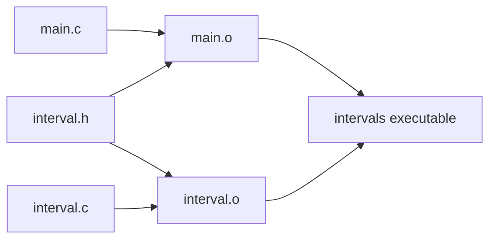

#### Modular Programs & Command Line

- [[#Public interface and implementation]]
- [[#Header guards]]
- [[#Separate compilation]]
- [[#Build dependencies]]
- [[#Command-line arguments]]
- [[#Converting a numeric argument]]

**[[#Public interface and implementation|Separation]]** Headers declare shared interfaces; source files define implementations.

**[[#Separate compilation|Object build]]** `gcc -c file.c` produces an object file; linking combines objects into an executable.

**[[#Command-line arguments|Arguments]]** `int main(int argc, char *argv[])`: check `argc` before using an argument; arguments arrive as strings.[^2]

## Public interface and implementation

A modular program separates what a component does from how it does it. A header can publish types, constants and function declarations; its corresponding source file supplies function definitions. Related operations can be grouped around a data type.[^1]

For example, `interval.h` can declare a type and its operation:

```c
#ifndef INTERVAL_H_INCLUDED
#define INTERVAL_H_INCLUDED

typedef struct {
    double low;
    double high;
} Interval;

double interval_width(Interval interval);

#endif
```

`interval.c` implements the operation:

```c
#include "interval.h"

double interval_width(Interval interval)
{
    return interval.high - interval.low;
}
```

The interface assumes `high >= low`. Documenting that condition is part of making the function usable: otherwise a negative width may be surprising.

The implementation includes its own header so the compiler can check its definition against the published declaration. Callers include the header rather than duplicating prototypes manually.

## Header guards

The `#ifndef`/`#define`/`#endif` pattern prevents a header's contents from being processed repeatedly in the same translation unit. Use a distinctive macro name that does not start with a reserved underscore pattern.

Guards do not mean a header is processed once for the entire program: each source file is preprocessed separately. They also do not make multiple ordinary function definitions in a header safe to link.

Keep dependencies focused. A header should include the standard or project headers required to make its own public declarations valid, but avoid pulling in unrelated interfaces. A single enormous global header makes changes affect more of the program than necessary.

## Separate compilation

A caller in `main.c` can use the interface without seeing the body:

```c
#include <stdio.h>
#include "interval.h"

int main(void)
{
    Interval span = {1.5, 4.0};
    printf("Width: %.1f\n", interval_width(span));
    return 0;
}
```

Build each source and then link:

```sh
gcc -std=c11 -Wall -Wextra -Werror -pedantic -c interval.c
gcc -std=c11 -Wall -Wextra -Werror -pedantic -c main.c
gcc interval.o main.o -o intervals
./intervals
```

The result is `Width: 2.5`. Each `.o` contains translated code and linking information, not generally a complete standalone executable. An object file does not need its own `main`; the hosted executable needs its entry point supplied by the program.

Compilation checks source using declarations. Linking resolves references across objects and libraries. Successful linking does not prove that every independently declared interface matches correctly, so consistent headers and compiler diagnostics remain important.

## Build dependencies

A build tool such as `make` records which outputs depend on which inputs:

```make
intervals: main.o interval.o
	gcc main.o interval.o -o intervals

main.o: main.c interval.h
	gcc -std=c11 -Wall -Wextra -Werror -pedantic -c main.c

interval.o: interval.c interval.h
	gcc -std=c11 -Wall -Wextra -Werror -pedantic -c interval.c
```

Recipe lines begin with a tab. If only `interval.c` changes, rebuild `interval.o` and relink. If `interval.h` changes, both objects depend on it and must be rebuilt. An unchanged source file may therefore still need recompilation because one of its included headers changed.

This avoids recompiling unrelated code while ensuring that changed interfaces are reflected in every dependent object.

### Which outputs must be rebuilt?



An arrow means **the output depends on this input**. Follow arrows from a changed file: changing `interval.c` affects one object and the executable, while changing `interval.h` affects both objects and the executable. The header supplies declarations during compilation; it is not a separately linked object.

## Command-line arguments

`argc` counts argument strings, normally including the program name. `argv` is an array of pointers to those strings, with `argv[argc] == NULL` as an end marker.

```c
#include <stdio.h>
#include <stdlib.h>

int main(int argc, char *argv[])
{
    if (argc != 2) {
        fprintf(stderr, "Supply one name\n");
        return EXIT_FAILURE;
    }
    printf("Hello, %s\n", argv[1]);
    return EXIT_SUCCESS;
}
```

Running `./greet Ada` supplies `Ada` as `argv[1]` and prints `Hello, Ada`. Check the count before indexing; an absent argument is not an empty string that can safely be used.

Numeric-looking arguments still arrive as character strings. `<stdlib.h>` supplies conversions including `atoi`, `atol` and `atof`, but these simple interfaces do not provide robust validation. For input that must be checked, prefer functions such as `strtol` with an end pointer and range checks. Do not confuse the character `'7'` or string `"7"` with the integer value `7`.


## Converting a numeric argument

A string-to-number conversion must check both the value and whether the entire string was valid. This program accepts one base-10 value within the range of `int`:

```c
#include <errno.h>
#include <limits.h>
#include <stdio.h>
#include <stdlib.h>

int main(int argc, char *argv[])
{
    if (argc != 2) {
        fprintf(stderr, "Supply one integer\n");
        return EXIT_FAILURE;
    }
    char *end;
    errno = 0;
    long value = strtol(argv[1], &end, 10);
    if (end == argv[1] || *end != '\0' || errno == ERANGE ||
        value < INT_MIN || value > INT_MAX) {
        fprintf(stderr, "Invalid integer\n");
        return EXIT_FAILURE;
    }
    int number = (int)value;
    printf("Value: %d\n", number);
    return EXIT_SUCCESS;
}
```

1. Check `argc` before accessing `argv[1]`.
2. Set `errno` to zero so an earlier unrelated error cannot be mistaken for this conversion's error.
3. `strtol` returns a `long` and sets `end` to the first character it did not convert.
4. `end == argv[1]` means no number was read. `*end != '\0'` means some trailing text remains.
5. Check range before converting from `long` to the narrower `int` type.

`./number 42` prints `Value: 42`; `./number 42x` is rejected rather than silently treated as 42. This interface accepts leading whitespace and a sign because `strtol` does; it rejects trailing whitespace as unconsumed text. Decide such input rules explicitly for a program rather than assuming a conversion function enforces them.

[^2]: Steve Gunn, [Week 5 — 19 October 2026 recording](https://southampton.cloud.panopto.eu/Panopto/Pages/Viewer.aspx?id=850012bc-558e-4a40-a7e3-b4e800f7537e), headers and build 42:23–46:59; command-line arguments 46:59–50:15. The checked conversion is an expanded example of the string-to-number step.

[^1]: https://moodle.ecs.soton.ac.uk/mod/resource/view.php?id=36216 — Data Structures & Dynamic Memory Allocation, Steve Gunn, Header and Source Files, makefile, and Command Line Arguments sections.
