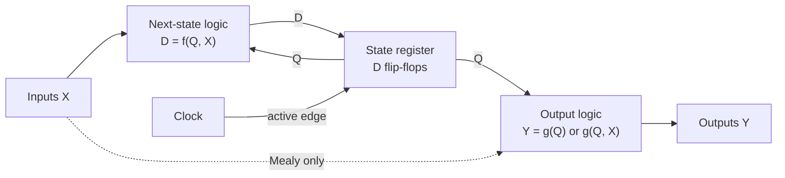
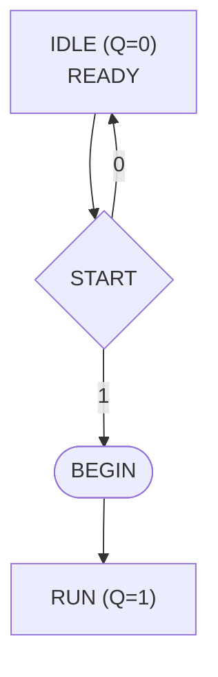
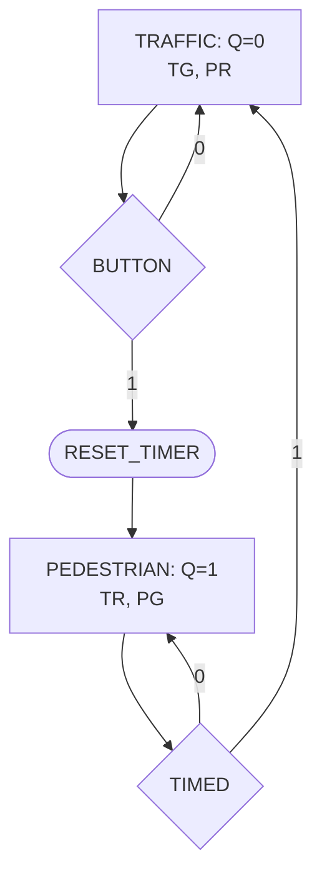

#### Algorithmic State Machines

- [[#State, next state and outputs]]
- [[#Reading an ASM chart]]
- [[#The design process]]
- [[#Worked binary counter]]
- [[#Worked Gray-code counter]]
- [[#Worked modulo-three up-down counter]]
- [[#Moore and Mealy outputs]]
- [[#Worked serial parity checker]]
- [[#Worked pedestrian controller]]
- [[#Checking a design]]

**State register:** $Q^+=D=f(Q,X)$ at the active clock edge.
**Minimum binary state bits:** $n=\lceil\log_2 N\rceil$ for $N$ states.
**Moore output:** $Y=g(Q)$. **Mealy output:** $Y=g(Q,X)$.
**Running odd parity:** $Q^+=Q\oplus X$.

## State, next state and outputs

![[Electronics (5)#Sequential Logic]]

A **finite-state machine (FSM)** represents a system using a finite set of remembered conditions called states. An **algorithmic state machine (ASM) chart** shows those states, the input decisions that select the next state, and the outputs active in each condition.[^asm]

A synchronous implementation has three parts:

1. A **state register** holds the present state $Q$.
2. **Next-state combinational logic** calculates $D=f(Q,X)$ from the present state and current inputs $X$.
3. **Output logic** calculates the required output signals.

The D flip-flops copy $D$ into $Q$ at the active clock edge. Before the edge, $Q$ still contains the old state even if $D$ already contains the new one. After the edge, the changed $Q$ causes the combinational logic to recalculate.

This is a circuit with feedback, not a processor executing the boxes one at a time. Several logic functions operate concurrently. Physical changes take propagation time; the instantaneous transition in the abstract state model assumes the setup, hold and clock-period requirements in [[Counters#Timing constraints]] are satisfied.

If there are $N$ distinct states, choose enough bits that $2^n\geq N$:

| States needed | Minimum binary state bits | Available bit patterns |
| --- | --- | --- |
| 2 | 1 | 2 |
| 3 | 2 | 4 |
| 4 | 2 | 4 |
| 5–8 | 3 | 8 |

Each binary state bit requires a flip-flop. A different encoding, such as one-hot, can deliberately use more bits; the table gives the minimum, not the only possible implementation.

The feedback path below separates stored state from the logic that calculates its next value. Only the register receives the clock; the other blocks respond combinationally.

## Reading an ASM chart

An ASM chart uses three principal shapes:[^asm]

- A **rectangular state box** identifies a stored state. Its name describes the condition; its binary assignment is the code stored in the state register.
- A **diamond decision box** tests an input or Boolean condition. Its exits must be labelled, normally 0 and 1.
- A **rounded conditional-output box** asserts an output only on the path containing that box.

An output written **inside a state box** is unconditional within that state: it depends on the state, not on the inputs. It is not necessarily asserted in any other state. Unless otherwise defined, an asserted active-high output is 1 and an unasserted output is 0.

An **ASM block** consists of one state box and its following decision/conditional-output boxes, ending before the next state box. Following a decision does not consume an extra clock cycle. The path selects a next state; the register moves there at the next active edge.

For example, this block asserts `READY` whenever the state is `IDLE`. `START=0` holds the state, while `START=1` asserts `BEGIN` and selects `RUN`:

Here `READY` is a state-dependent output. `BEGIN` depends on both being in `IDLE` and `START=1`. The diagram is a partial illustration: a complete design must also specify how `RUN` leaves or holds its state.

## The design process

1. **Define the behaviour.** Name every input/output, say what 1 means, and state assumptions such as whether an input lasts one cycle or remains asserted.
2. **Identify the memory needed.** Two situations require different states if the same future input sequence must produce different future behaviour.
3. **Draw the ASM chart.** Include hold paths and each input condition; every possible input combination must lead to one next state.
4. **Assign binary codes.** For example, three states may use 00, 01 and 10. List unused codes separately.
5. **Build the transition/output table.** Each row contains present state, input condition, next state and outputs.
6. **Derive one Boolean expression for each next-state bit and output.** Use truth tables, algebra or Karnaugh maps.
7. **Implement and check.** Connect next-state expressions to D inputs, share the clock, define reset, and trace complete input sequences.[^asm]

The output columns in a transition table describe the **present** state and current inputs, not the outputs of the next state. For example, a transition from 00 to 01 does not make the present-state LSB output 1 before the clock edge.[^friday]

State codes and output values are different concepts. An output may equal a state bit in a convenient encoding, but this is not required.

## Worked binary counter

Design a two-bit counter with sequence
$$00\rightarrow01\rightarrow10\rightarrow11\rightarrow00.$$

There are four states, so two D flip-flops are sufficient. Choose the state assignment equal to the count. With no external control inputs, each present state has exactly one successor:[^binary]

| Present $Q_1Q_0$ | Next $D_1D_0$ | MSB | LSB |
| --- | --- | --- | --- |
| 00 | 01 | 0 | 0 |
| 01 | 10 | 0 | 1 |
| 10 | 11 | 1 | 0 |
| 11 | 00 | 1 | 1 |

Derive the two D-input equations separately:

1. $D_0$ is 1 in rows 00 and 10, precisely when $Q_0=0$. Therefore $D_0=\overline{Q_0}$.
2. $D_1$ is 1 in rows 01 and 10. Its sum of products is
   $$D_1=\overline{Q_1}Q_0+Q_1\overline{Q_0}=Q_1\oplus Q_0.$$
3. Connect those expressions to the D inputs of two flip-flops on the same clock.
4. The outputs are $\mathrm{MSB}=Q_1$ and $\mathrm{LSB}=Q_0$.

Check the edge from 01: calculate **both** D inputs using old $Q_1=0,Q_0=1$, giving $D_1D_0=10$. Only then update the register. Calculating the second bit using the already updated first bit would describe a different circuit.

## Worked Gray-code counter

A two-bit Gray-code sequence is
$$00\rightarrow01\rightarrow11\rightarrow10\rightarrow00.$$
Only one output bit changes on each transition, including the wraparound. Assign each state the Gray-code output itself:[^gray]

| Present $Q_1Q_0$ | Next $D_1D_0$ |
| --- | --- |
| 00 | 01 |
| 01 | 11 |
| 11 | 10 |
| 10 | 00 |

Reading the columns gives
$$\boxed{D_1=Q_0,\qquad D_0=\overline{Q_1}}.$$

For example, present state 01 gives $D_1=1$ and $D_0=1$, hence next state 11. This counter still has modulus four: Gray coding changes the sequence of bit patterns, not the number of states.

Choosing ordinary binary state codes and separately decoding Gray outputs is also possible. It produces different equations because the stored code is different. Always state the assignment before deriving equations.

## Worked modulo-three up-down counter

Use states 00, 01 and 10. Let $M=\mathrm{MODE}$, with $M=0$ counting up and $M=1$ counting down. The outputs are the two stored count bits.[^modthree]

- Up: $00\rightarrow01\rightarrow10\rightarrow00$.
- Down: $00\rightarrow10\rightarrow01\rightarrow00$.

The transition table must include the input as well as the state:

| $Q_1Q_0$ | $M$ | Next $D_1D_0$ |
| --- | --- | --- |
| 00 | 0 | 01 |
| 00 | 1 | 10 |
| 01 | 0 | 10 |
| 01 | 1 | 00 |
| 10 | 0 | 00 |
| 10 | 1 | 01 |
| 11 | 0 | 00 |
| 11 | 1 | 00 |

The final two rows are an explicit recovery choice: unused state 11 returns to 00 on the next edge. They are not additional counting states.

### Derive the equations

$D_1=1$ only for $(Q_1,Q_0,M)=(0,0,1)$ and $(0,1,0)$:
$$\begin{aligned}
D_1&=\overline{Q_1}\,\overline{Q_0}M+\overline{Q_1}Q_0\overline M\\
&=\overline{Q_1}(Q_0\oplus M).
\end{aligned}$$

$D_0=1$ only for $(0,0,0)$ and $(1,0,1)$:
$$\begin{aligned}
D_0&=\overline{Q_1}\,\overline{Q_0}\,\overline M+Q_1\overline{Q_0}M\\
&=\overline{Q_0}\,\overline{(Q_1\oplus M)}.
\end{aligned}$$

Check the valid-state cycles using these expressions. At state 10 with $M=1$, $D_1=0$ and $D_0=1$, so it counts down to 01. At unused state 11, the leading factors force both outputs to zero for either $M$.

Treating unused states as don't-cares during minimisation can yield simpler logic, but then their behaviour must be checked after minimisation. A reset provides a known starting state; it does not prove that an unused state could never be entered after a disturbance.

### Minimise using unused-state don't-cares

If the specification leaves state 11 undefined, its two rows may instead be marked as don't-cares. With Karnaugh-map columns $Q_1Q_0=00,01,11,10$ and rows $M=0,1$:

- For $D_1$, group the 1 at $(M,Q_1Q_0)=(0,01)$ with the don't-care at $(0,11)$, giving $\overline M Q_0$. The remaining isolated 1 at $(1,00)$ gives $M\overline{Q_1}\overline{Q_0}$.
- For $D_0$, group the 1 at $(1,10)$ with the don't-care at $(1,11)$, giving $M Q_1$. The isolated 1 at $(0,00)$ gives $\overline M\overline{Q_1}\overline{Q_0}$.

Thus another valid implementation is[^friday]
$$D_1=M\overline{Q_1}\overline{Q_0}+\overline M Q_0,$$
$$D_0=\overline M\overline{Q_1}\overline{Q_0}+M Q_1.$$

These equations agree with the earlier recovery-to-00 design on all six valid-state/input combinations. They behave differently in unused state 11: $M=0$ gives next state 10, while $M=1$ gives 01. Both enter a valid state after one edge, but neither implements the earlier explicit 11-to-00 requirement. A don't-care is permission to choose behaviour during minimisation, not a physical third logic value.

For a readable hardware schematic, place labelled rails for $M,\overline M,Q_1,\overline{Q_1},Q_0,\overline{Q_0}$ alongside the AND terms, combine each set through an OR gate, and feed the result into its corresponding D input. Keep both flip-flops on the same clock and take the count outputs from Q, not D. This layout makes connections easier to trace than crossing feedback wires through the gate network.[^friday]

## Moore and Mealy outputs

| Property | Moore | Mealy |
| --- | --- | --- |
| Output function | $Y=g(Q)$ | $Y=g(Q,X)$ |
| ASM indication | Outputs in state boxes only | At least one conditional output |
| Input changes with state held | Do not change ideal logical output | Can change output immediately after combinational delay |
| Additional states | May need an output state | Can sometimes produce the output on a transition path |

A Moore circuit may still use inputs to select the **next** state. That does not make it Mealy; classification depends on the **output** equations.[^outputs]

Moore outputs normally change as the state changes after a clock edge. However, decoded outputs can glitch while multiple state bits settle. Mealy outputs can also respond to input glitches between edges. Neither name alone guarantees safe timing or glitch-free physical outputs; register critical outputs or use an appropriate implementation when required.

## Worked serial parity checker

Even parity means that the total number of 1 bits, including any parity bit, is even. An extra 0 leaves parity unchanged; an extra 1 reverses it. Only two remembered conditions are required: **even** and **odd**.[^parity]

Assign $Q=0$ to even and $Q=1$ to odd. Initialise $Q=0$, because no received bits means zero 1s, an even number. Let $X$ be the next bit at the input.

| Present $Q$ | Input $X$ | Next $D$ | Moore `FAIL` | Mealy `FAIL_NEXT` |
| --- | --- | --- | --- | --- |
| 0 | 0 | 0 | 0 | 0 |
| 0 | 1 | 1 | 0 | 1 |
| 1 | 0 | 1 | 1 | 1 |
| 1 | 1 | 0 | 1 | 0 |

The next-state equation is
$$D=\overline XQ+X\overline Q=Q\oplus X.$$

### Moore interpretation

$$\mathrm{FAIL}=Q.$$

Before the next edge, `FAIL` reports parity of the bits **already sampled**. At the edge, $Q$ takes $Q\oplus X$, so after the register delay `FAIL` reports parity including the newly sampled bit.

For input sequence $0,1,1,0,1$, trace the state after each edge:

| Sampled bit | Total number of sampled 1s | State after edge | `FAIL` |
| --- | --- | --- | --- |
| 0 | 0 | Even | 0 |
| 1 | 1 | Odd | 1 |
| 1 | 2 | Even | 0 |
| 0 | 2 | Even | 0 |
| 1 | 3 | Odd | 1 |

### Mealy interpretation

$$\mathrm{FAIL\_NEXT}=Q\oplus X=D.$$

This combinational output describes the parity that would result from accepting the **current input** into the stored parity. It can change before the edge, while $Q$ is unchanged. It is not simply interchangeable with a registered `FAIL` signal at every moment.

For example, while $Q=0$ and $X=1$, the Moore output is 0 but `FAIL_NEXT` is 1. After the edge, $Q=1$; if $X$ remains 1, the combinational expression immediately becomes 0 because it now describes adding another 1. A receiving circuit must use the intended sampling instant and protocol, not interpret the entire Mealy waveform as the already-accepted parity.

A running odd count is not itself proof that transmitted data is corrupt. Check parity at the defined end of a word including its parity bit. A parity check detects any odd number of flipped bits, but an even number of flips can preserve parity and go undetected.

## Worked pedestrian controller

Consider an idealised synchronous teaching model with two light phases, `TRAFFIC` and `PEDESTRIAN`. It is not a complete road-crossing safety design: amber/all-red intervals, input synchronisation, timing tolerances and fail-safe hardware would need separate treatment.[^crossing]

### While-pressed version

Let $B$ mean the pedestrian button is pressed. Assign $Q=0$ to traffic green/pedestrian red and $Q=1$ to traffic red/pedestrian green. To follow the button at clock edges,
$$D=B.$$
The outputs are
$$\mathrm{TG}=\mathrm{PR}=\overline Q,\qquad
\mathrm{TR}=\mathrm{PG}=Q.$$
Both states select their successor from $B$. The outputs depend only on $Q$, so this is Moore behaviour. It reacts on a clock edge, not instantaneously when the button changes.

### Timed version

A press starts a 30-second pedestrian phase. A separate timer provides $T=1$ for one clock cycle when the interval has elapsed. `RESET_TIMER` starts that timer; the controller does not count 30 seconds using only its two state codes.

| Present $Q$ | Button $B$ | Timed $T$ | Next $D$ | `RESET_TIMER` | TG, PR | TR, PG |
| --- | --- | --- | --- | --- | --- | --- |
| 0 | 0 | Either | 0 | 0 | 1 | 0 |
| 0 | 1 | Either | 1 | 1 | 1 | 0 |
| 1 | Either | 0 | 1 | 0 | 0 | 1 |
| 1 | Either | 1 | 0 | 0 | 0 | 1 |

Derivation:

1. In traffic state, enter pedestrian state if $B=1$: the term is $B\overline Q$.
2. In pedestrian state, remain there while the timer has not finished: the term is $\overline TQ$.
3. Combine the two conditions:
   $$\boxed{D=B\overline Q+\overline TQ}.$$
4. Start the timer only on the button-selected exit from traffic:
   $$\boxed{\mathrm{RESET\_TIMER}=B\overline Q}.$$
5. The light equations remain $\mathrm{TG}=\mathrm{PR}=\overline Q$ and $\mathrm{TR}=\mathrm{PG}=Q$.

`RESET_TIMER` is conditional, so the whole controller is Mealy even though the lights themselves are state-dependent. Under the synchronous-input model, it is asserted for the traffic-to-pedestrian transition interval and is removed when $Q$ becomes 1. An asynchronous button can make this a partial-cycle signal, so a physical implementation must synchronise it and meet the timer's interface requirements.

If the button remains pressed when the timed phase ends, this simple model can start another pedestrian phase after returning to traffic. Requiring a new press would need additional remembered information, such as a wait-for-release state. Always distinguish “button is high” from “a new press has occurred”.

## Checking a design

- **Completeness:** every valid state and input combination has one defined next state.
- **Output timing:** label whether each output describes the current state, the current input-conditioned path or a registered result.
- **Initialisation:** define what reset means and ensure the reset code exists.
- **Unused encodings:** evaluate their actual next states; do not assume they recover.
- **Event duration:** trace an input held for several cycles, not only a single-cycle pulse.
- **Clock timing:** account for propagation, setup and hold; no decision diamond represents an extra clock tick.
- **Equivalence:** enumerate the transition table and confirm the minimised equations produce every specified row.

[^asm]: Geoff Merrett, [ASM Design](https://moodle.ecs.soton.ac.uk/mod/resource/view.php?id=36344), pp. 3–9, 12 and 17. The general state-bit count and explicit ASM-block interpretation develop the synchronous design model.
[^binary]: [ASM Design](https://moodle.ecs.soton.ac.uk/mod/resource/view.php?id=36344), pp. 5–10, binary-counter specification. Table and equations are derived from its stated sequence, consistent with [[Counters#Synchronous counters]].
[^gray]: [ASM Design](https://moodle.ecs.soton.ac.uk/mod/resource/view.php?id=36344), pp. 12–14, Gray-counter specification; transition table and equations derived here with stored code equal to output code.
[^modthree]: [ASM Design](https://moodle.ecs.soton.ac.uk/mod/resource/view.php?id=36344), pp. 17–19. The six valid-state rows follow the specification; recovery of 11 to 00 is an explicitly chosen completion, not a supplied whiteboard solution.
[^outputs]: [ASM Design](https://moodle.ecs.soton.ac.uk/mod/resource/view.php?id=36344), pp. 26–31. Physical timing caveats distinguish the ideal state model from propagation effects.
[^parity]: [ASM Design](https://moodle.ecs.soton.ac.uk/mod/resource/view.php?id=36344), pp. 21–31, especially the complete tables/circuits on pp. 30–31. These establish that `FAIL=1` represents odd parity; the repeated “even” in the final bullet on p. 24 is a typographical error. The Mealy sampling example makes the timing of the supplied $\mathrm{FAIL}=Q_n$ circuit explicit.
[^crossing]: [ASM Design](https://moodle.ecs.soton.ac.uk/mod/resource/view.php?id=36344), pp. 32–38, button-controlled and timed pedestrian-controller specifications and timed solution.

[^friday]: [30 October 2026 ASM Part 2](https://southampton.cloud.panopto.eu/Panopto/Pages/Viewer.aspx?id=dd15ee6c-a9f9-40c7-9c48-b4f300f74909), 13:27–14:36 present-state outputs, 33:10–38:06 unused-state minimisation (equations checked against the handwriting at 37:47), 38:26–42:33 structured schematic. [Part 1](https://southampton.cloud.panopto.eu/Panopto/Pages/Viewer.aspx?id=ee563343-ce08-42f4-8ebf-b4f300c5f78f), 20:11–44:56, covers the state model and binary-counter derivation. October 30 teaching ends at the modulo-three counter; Part 2 at 43:27–43:35 defers parity to the following week. The subsequent Moore/Mealy, parity and pedestrian sections above develop the published slides rather than material verified as taught on October 30.
