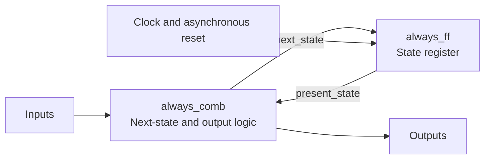

#### SystemVerilog Sequential Design

- [[#Counter width and wraparound]]
- [[#Serial-in parallel-out register]]
- [[#Two-process state machines]]
- [[#Worked sampling controller]]
- [[#Default assignments and unintended memory]]
- [[#Scaling the pattern]]
- [[#Checking a sequential model]]

**Clocked update:** `q <= expression;` captures a value for the next stored state.
**Unsigned N-bit counter:** $Q^+=(Q+1)\bmod 2^N$.
**State machine:** $S^+=f(S,X)$; outputs are $g(S)$ or $g(S,X)$.

See [[Controller and Datapath]] for coordinating a state machine with registers and counters.[^coverage]

## Counter width and wraparound

A register stores a fixed number of bits, not an unbounded mathematical integer. Consider this unsigned binary counter:[^counter]

```systemverilog
module counter #(parameter N = 8) (
    output logic [N-1:0] q,
    input logic clk, n_reset
);
    always_ff @(posedge clk or negedge n_reset)
        if (!n_reset)
            q <= '0;
        else
            q <= q + 1;
endmodule
```

The active-low asynchronous reset clears the register when `n_reset` falls. Otherwise a rising clock edge increments the stored word. Nonblocking assignment `<=` describes the clocked update; it is not a less-than comparison in this position. Write the next-state expression explicitly rather than obscuring the clocked assignment with `q++`.

For $N=3$, the sequence is
$$000\rightarrow001\rightarrow010\rightarrow011\rightarrow100\rightarrow101\rightarrow110\rightarrow111\rightarrow000.$$

Mathematically, $7+1=8$, whose binary representation is `1000`. Assignment back into three bits retains only `000`: the fourth bit is discarded. The rollover is a consequence of the destination width, **not the reset input being asserted**.

This is useful for a modulo-$2^N$ counter but dangerous if a calculation needs its carry. To preserve an unsigned carry, provide an $N+1$-bit destination and deliberately extend the operands. Do not assume that a wider intermediate calculation means the narrower stored result keeps its high bits.

See [[Counters]] for the hardware interpretation and timing constraints.

## Serial-in parallel-out register

For $N\geq2$, a serial-in, parallel-out register can use concatenation:[^shift]

```systemverilog
module sipo #(parameter N = 8) (
    output logic [N-1:0] q,
    input logic a, clk
);
    always_ff @(posedge clk)
        q <= {q[N-2:0], a};
endmodule
```

The braces join bit vectors. The right-hand side contains the old low $N-1$ bits followed by the new one-bit input `a`. It therefore has exactly $N$ bits:

- The old most significant bit `q[N-1]` is discarded.
- Each remaining old bit moves one position toward the most significant end.
- The new serial input becomes `q[0]`.
- Every right-hand-side bit is taken from the **old** word; one edge does not repeatedly shift the already updated word.

For a four-bit word initially `0000` and serial inputs `1,0,1,1`:

| Rising edge | Sampled `a` | New `q[3:0]` |
| --- | --- | --- |
| 1 | 1 | 0001 |
| 2 | 0 | 0010 |
| 3 | 1 | 0101 |
| 4 | 1 | 1011 |

The first sampled bit is now at the most significant end. This code has **no reset**, so the initial `0000` is an assumption for the example, not behaviour promised by the module. After four captures, all four positions contain known sampled data regardless of the previous contents, provided the input samples are known. Compare the bit-order conventions in [[Registers]].

## Two-process state machines

A hardware description is a collection of concurrent blocks, not a single program stepping through all its source lines. A two-process FSM separates storage from combinational calculation:[^fsm]



- `present_state` is the state currently stored in the flip-flops.
- `next_state` is a combinational signal specifying what the register should capture at the next active edge.
- `always_ff` updates the register using nonblocking assignments.
- `always_comb` computes outputs and next state using blocking assignments.
- An enumerated type supplies meaningful state names. The description need not manually assign a binary code to each name; synthesis can choose an implementation encoding.

An ASM state box maps to a `case` branch. An input decision maps to an `if` inside that branch. Moore outputs depend only on the present state; Mealy outputs also depend on current inputs. Review [[Algorithmic State Machines]] for chart conventions.

## Worked sampling controller

A controller starts one conversion when it sees a request in `IDLE`, then waits in `WAIT_DONE` until the converter reports completion. It does not perform the conversion itself.[^traffic]

- `busy` is a Moore output: it is high whenever the controller is waiting.
- `start_conversion` is a Mealy output: it depends on both the state and the current `request`.
- Assume `request` and `done` are synchronous to `clk`, and that a source withdraws an accepted request. A request held until the controller comes back to `IDLE` can be accepted again.

```systemverilog
module sample_control (
    input  logic clk, reset_n, request, done,
    output logic busy, start_conversion
);
    typedef enum logic { IDLE, WAIT_DONE } state_t;
    state_t state, next_state;

    always_ff @(posedge clk or negedge reset_n) begin
        if (!reset_n)
            state <= IDLE;
        else
            state <= next_state;
    end

    always_comb begin
        busy = 1'b0;
        start_conversion = 1'b0;
        next_state = state;

        unique case (state)
            IDLE: begin
                if (request) begin
                    start_conversion = 1'b1;
                    next_state = WAIT_DONE;
                end
            end
            WAIT_DONE: begin
                busy = 1'b1;
                if (done)
                    next_state = IDLE;
            end
        endcase
    end
endmodule
```

| Present state | Relevant input | `busy` | `start_conversion` | State captured at the next edge |
| --- | --- | --- | --- | --- |
| `IDLE` | `request=0` | 0 | 0 | `IDLE` |
| `IDLE` | `request=1` | 0 | 1 | `WAIT_DONE` |
| `WAIT_DONE` | `done=0` | 1 | 0 | `WAIT_DONE` |
| `WAIT_DONE` | `done=1` | 1 | 0 | `IDLE` |

For example, if `request` goes high between edges while in `IDLE`, `start_conversion` can go high before `busy` does. At the edge the state becomes `WAIT_DONE`, and after the state propagates through the output logic, `busy` goes high and `start_conversion` goes low. A short asynchronous request would need separate capture or synchronisation; that is not what this block provides.


## Default assignments and unintended memory

The defaults at the top of `always_comb` run every time that block evaluates. They are **default assignments**, not one-time initialisation:[^defaults]

- Deassert every output unless a branch overrides it.
- Hold the state unless a branch selects a different one.

If a combinational output is left unassigned on some path, the model must retain its old value on that path. That introduces unintended storage, usually a latch, alongside the intended clocked state register. A default assignment avoids repeating the same zero or hold assignment in every branch.

Holding `next_state = present_state` is not a combinational latch: the next-state signal is explicitly assigned from the state-register output. In contrast, omitting an assignment and asking the combinational signal itself to remember its previous value is unintended memory.

`unique case` expresses that exactly one case item should match; simulation tools can warn about missing or multiple matches. It is useful checking intent, **not a replacement for complete assignments or a guarantee of recovery from a corrupted state**. Reset and invalid-state behaviour still need deliberate consideration.

## Scaling the pattern

A vending-machine controller can use named states for the accumulated credit, a dispense state and a return state for an overpayment. The particular state names change, but the architecture does not:[^vending]

1. Declare the states and the present/next-state signals.
2. Reset the state register to the initial state.
3. Use one combinational branch per state.
4. Describe outputs and input-dependent next-state decisions.
5. Assign every combinational result on every path.

The example's outputs are Moore outputs: each is associated with a state rather than being conditional on an input within that state. More states make the transition logic longer, but they do not require a different state-register template.

An alternative that puts outputs inside a clocked block stores those outputs in flip-flops and changes their timing. It is not automatically equivalent to moving the same lines from `always_comb` to `always_ff`. Use the receiving logic's timing requirements to decide whether outputs should be registered.

## Checking a sequential model

- Identify every register and what active edge or reset changes it.
- Check widths, especially counter overflow and slices used in concatenation.
- Ensure each stored/combinational signal has its intended single driver.
- Trace outputs from **present** state and current inputs, then update the state at the edge.
- Exercise hold and transition paths, reset, wraparound and input changes between edges.
- Check that combinational defaults cover every output and `next_state`.
- Do not mistake a source-level declaration or a worked example's initial word for an implemented reset.

[^coverage]: [ELEC1313 module, Sequential SystemVerilog section](https://moodle.ecs.soton.ac.uk/course/view.php?id=901), syllabus exclusions checked 10 November 2026. [9 November recording](https://southampton.cloud.panopto.eu/Panopto/Pages/Viewer.aspx?id=72e2532f-28b6-489e-bae1-b4fd011875dc), 9:14–9:40 and 42:42–42:50 distinguish the following day's testbench teaching.
[^counter]: Mark Zwolinski, [SystemVerilog for Sequential Design (1)](https://moodle.ecs.soton.ac.uk/mod/resource/view.php?id=36369), Binary Counter; [9 November recording](https://southampton.cloud.panopto.eu/Panopto/Pages/Viewer.aspx?id=72e2532f-28b6-489e-bae1-b4fd011875dc), 3:09–6:35, particularly discarded carry and fixed-width arithmetic.
[^shift]: Same Lecture 5 slides, Serial-in, Parallel-out Shift Register; 9 November recording, 6:41–9:04. Four-bit trace is an illustrative check of the taught expression.
[^fsm]: [SystemVerilog for Sequential Design (2)](https://moodle.ecs.soton.ac.uk/mod/resource/view.php?id=36374), State Machines; 9 November recording, 11:04–19:11.
[^traffic]: Same Lecture 6 slides, Traffic Light Controller and ASM chart; 9 November recording, 19:17–33:32. The sampling controller and timing table are original examples of the two-process pattern.
[^defaults]: Same Lecture 6 slides, Comments; 9 November recording, 33:10–36:36. The distinction between checking intent and fault recovery clarifies the limits of `unique case`.
[^vending]: Same Lecture 6 slides, Vending Machine; 9 November recording, 38:16–42:25. No excluded “Version 2” implementation is reproduced here.
